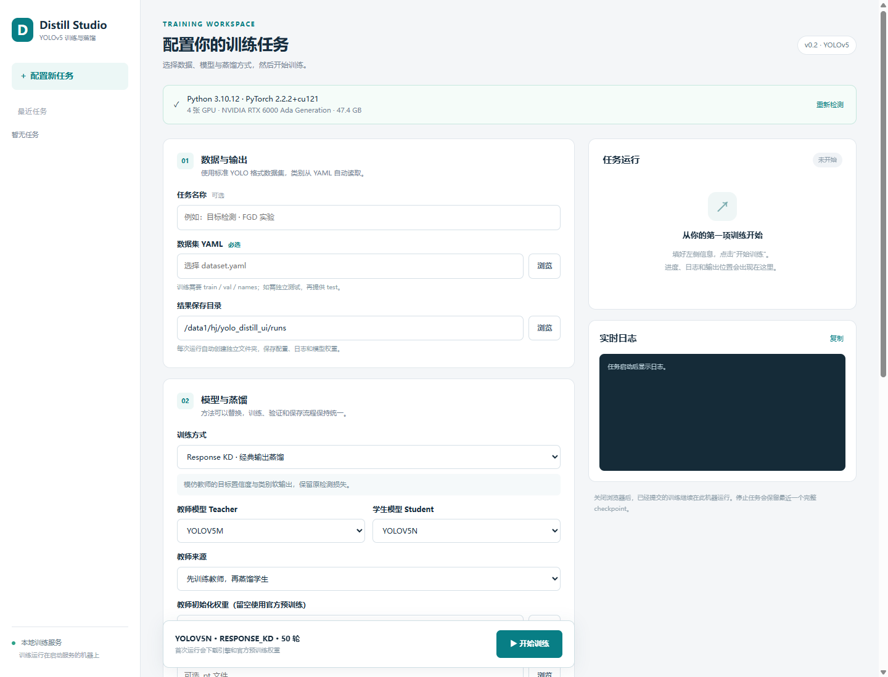
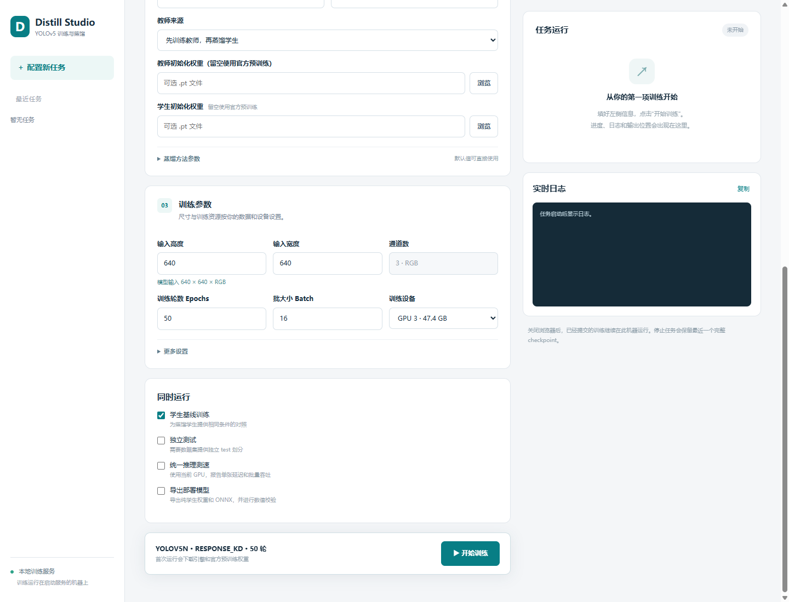

# YOLO Distill Tool

一个可直接配置、运行的 **YOLOv5 训练与知识蒸馏工作台**。选择自己的数据集、教师与学生模型、蒸馏方法和训练参数，点击 **开始训练**，即可查看进度、日志，并停止或恢复任务。

[](https://github.com/worshipyour/yolo-distill-tool/actions/workflows/tests.yml)




界面示例。设备信息与默认保存位置按实际运行机器读取，数据集和训练参数由用户选择。

<details>
<summary>查看输入尺寸、训练参数与可选评测设置</summary>



</details>

## 支持什么

| 功能 | 当前支持 |
| --- | --- |
| 检测器 | 固定版本 YOLOv5 v7.0；n / s / m / l / x |
| 训练方式 | 常规训练、Response KD、FGD、已安装的方法插件 |
| 教师来源 | 先训练教师，或加载已在目标类别上训练好的教师权重 |
| 输入 | 自定义高宽、RGB；内部自动补边到 stride32 的整数倍 |
| 任务管理 | 后台训练、实时日志、轮数进度、任务历史、停止与 checkpoint 恢复 |
| 可选处理 | 学生基线对照、独立测试、GPU 测速、纯检测器权重与 ONNX 导出 |

工作台使用浏览器界面和本地 Python 服务，共用 CLI 训练后端，不依赖 Qt。当前适配 YOLOv5 系列；其他检测器需要新增引擎适配。蒸馏方法接入成功不保证每个数据集的精度都会提升。

## 1. 下载并启动

先准备 **Python 3.10 或 3.11** 与 **Git**。GPU 训练推荐 Linux + NVIDIA GPU，需安装兼容 CUDA 12.1 的驱动；首次运行需要联网下载依赖、引擎和预训练权重。

```bash
git clone https://github.com/worshipyour/yolo-distill-tool.git
cd yolo-distill-tool
```

**Windows：** 双击 `start.bat`，或在 PowerShell 中运行：

```powershell
.\start.bat
```

**Linux：**

```bash
bash start.sh
```

首次启动会创建项目内的 `.venv` 并安装依赖。安装完成后自动打开 **http://127.0.0.1:8765**；之后运行同一启动脚本即可。

如需指定 Python 路径、安装 CPU 版本或手动安装，见 [安装与使用说明](docs/UI.zh-CN.md#安装与启动)。已安装项目时，也可直接运行 `distill-tool ui`。

## 2. 准备自己的数据

使用标准 **YOLO 目标检测格式**。图片与标签分别位于 `images`、`labels` 的对应子目录，同名图片对应一个 `.txt` 标签：

```text
my-dataset/
├── dataset.yaml
├── images/
│   ├── train/001.jpg
│   └── val/002.jpg
└── labels/
    ├── train/001.txt
    └── val/002.txt
```

`dataset.yaml` 示例（相对路径按 YAML 所在目录解析）：

```yaml
path: .
train: images/train
val: images/val
names:
  0: cat
  1: dog
# 如需独立测试，另外提供不与 train/val 重叠的 test 路径。
# test: images/test
```

每行标签为 `class_id center_x center_y width height`，坐标归一化到 `[0, 1]`。例如：

```text
0 0.5 0.5 0.3 0.4
```

常规训练只需要 `train / val / names`；启用独立测试时还需要 `test`。已有教师权重的类别数量和顺序必须与当前数据集一致。

## 3. 配置并开始训练

1. 选择 `dataset.yaml` 和结果保存目录。
2. 选择常规训练、**Response KD** 或 **FGD**；蒸馏时选择教师来源和学生模型。
3. 设置输入高宽、训练轮数、batch 和设备；模型初始化权重留空时使用对应的官方预训练权重。
4. 按需勾选学生基线、独立测试、测速或 ONNX 导出。
5. 点击 **开始训练**。进度和日志在右侧更新，模型与报告保存到独立任务目录。

默认 batch 为16，请按显存和输入尺寸调整。关闭浏览器后，已提交的训练继续运行。停止任务后可从最近一个完整 checkpoint 恢复；第一轮尚未保存 checkpoint 时，需要新建任务。

## 在 GPU 服务器上使用

在服务器克隆项目后启动：

```bash
bash start.sh --no-browser
```

在本机终端保持 SSH 端口转发：

```bash
ssh -L 8765:127.0.0.1:8765 user@your-server
```

然后用本机浏览器打开 **http://127.0.0.1:8765**。界面中的文件路径和 GPU 都属于服务器；本机断开连接或休眠不会停止已提交的服务器训练。服务默认仅监听回环地址。

## 输出与命令行

```text
任务输出目录/
├── train/<stage>/weights/   # best.pt、last.pt、可恢复的 resume.pt
├── logs/                   # 各训练阶段日志
├── evaluation/             # 启用独立测试/测速时的指标
├── deploy/                 # 启用导出时的纯检测器权重与 ONNX
└── REPORT.md               # 本次实际运行步骤的报告
```

任务记录默认保存在 `~/.yolo-distill/jobs`。蒸馏后的学生部署不包含教师和蒸馏损失模块。ONNX 输出为解码候选框，NMS 与坐标还原由图外后处理完成。

高级用户可以使用 [通用 YAML 配方](recipes/general.yaml) 调用相同后端：

```bash
# 仅 CLI 首次使用时准备引擎，已有引擎目录可跳过。
distill-tool bootstrap --engine vendor/yolov5
# 修改示例里的数据、输出目录和训练参数后运行。
distill-tool plan recipes/general.yaml
distill-tool doctor recipes/general.yaml
distill-tool run recipes/general.yaml
distill-tool run recipes/general.yaml --resume
```

## 扩展与验证

通过 `distill_tool.methods` entry point 安装的方法插件会自动出现在方法选择框。内置方法提供参数表单，其他插件可填写附加参数，详见 [方法接口与公式](docs/METHODS.md)。

- [完整工作台说明](docs/UI.zh-CN.md)：安装、设备选择、服务器访问与恢复。
- [架构与支持边界](docs/PLAN.zh-CN.md)：模块复用、任务运行和后续方向。
- [HaGRID 专项示例](docs/HAGRID_EXAMPLE.zh-CN.md)：可选的数据转换与完整对照实验。
- [验收环境版本](requirements/verified-linux-py310-cu121.txt)：已验证的 Linux GPU 环境快照。

v0.2 已通过31项自动检查；Linux GPU 上实际验证了浏览器提交的常规训练、Response KD、FGD、ONNX 导出，以及停止后恢复训练。Windows 提供安装和启动入口，完整 Windows GPU 训练仍需在目标环境验证。短训练验证工程链路，不代表蒸馏一定提高精度。

贡献代码前可运行检查（需安装训练依赖和 `.[test]`，并准备固定版本引擎）：

```bash
python -m pytest -q
```

## 许可与来源

项目采用 **GPL-3.0**。YOLOv5 固定在 v7.0 / `915bbf294bb74c859f0b41f1c23bc395014ea6679`；FGD 参考实现及 Apache-2.0 许可保留在 `tests/reference`。详见 [LICENSE](LICENSE) 和 [THIRD_PARTY.md](THIRD_PARTY.md)。

数据集和训练权重需自行准备，仓库不包含数据、模型大文件或服务器凭据。
