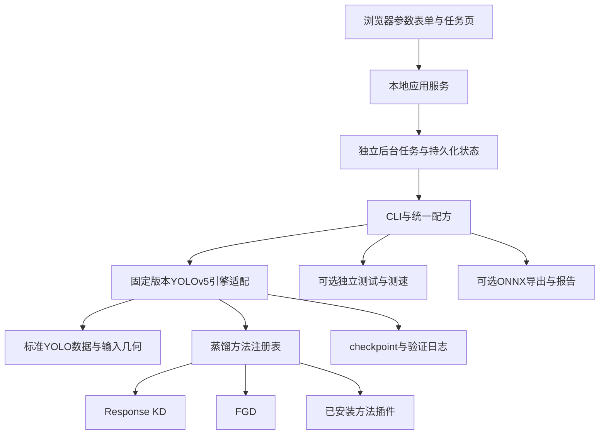

# 架构与支持范围

工作台将数据、训练引擎、蒸馏方法和任务管理组织成可复用模块。浏览器界面和CLI共用同一套配方与训练后端，增加方法时不需要重写界面或训练循环。

## 模块职责

|位置|职责|
|---|---|
|`distill_tool/web.py`|回环地址HTTP服务、界面资源和任务API|
|`distill_tool/ui_static/`|通用参数表单、文件浏览器、任务历史与日志页|
|`distill_tool/jobs.py`|表单转配方、独立进程、状态持久化、停止与恢复|
|`distill_tool/config.py`|配方解析、路径解析、参数校验和指纹|
|`distill_tool/pipeline.py`|训练阶段、权重选择、独立测试和部署流程|
|`distill_tool/engine/`|固定版本YOLOv5训练器适配、尺寸和教师前向|
|`distill_tool/methods/`|蒸馏损失、参数及插件注册接口|
|`distill_tool/data.py`|YOLO数据审查与可选HaGRID转换|
|`distill_tool/benchmark.py`|统一GPU计时及吞吐测量|
|`distill_tool/deploy.py`|纯检测器推理、内部补边和ONNX导出|

## 训练与恢复

任务按用户选择执行教师训练、学生基线和蒸馏训练。已有教师权重时跳过教师训练；常规训练只运行学生检测器。每个任务保存解析后的配方、阶段日志和checkpoint，配置改变时使用新的工作目录。

`resume.pt`保留检测器、蒸馏模块、优化器、EMA和AMP scaler。恢复使用相同配方，已完成阶段可以跳过。多进程数据预取不能逐样本重放，因此不承诺续跑与不中断训练逐位一致。

界面只提交后台任务；关闭浏览器后任务继续运行。任务服务默认监听回环地址，服务器访问使用SSH端口转发。SSH凭据由用户自己的SSH客户端管理，不写入配方或仓库。

## 方法与模型边界

当前支持YOLOv5 n/s/m/l/x、RGB输入和单张GPU或CPU训练。网络内部自动补边到stride32倍数，并同步变换标签。学生与教师的检测尺度、类别和适用的anchor条件在训练时检查。

方法插件实现`DistillationMethod`并通过entry point注册，安装后自动显示在方法列表。特征通道从网络读取；新增损失使用现有引擎提供的输出和特征。需要其他检测头或其他网络输出的方法，应扩展引擎能力并单独验证。详见[方法接口](METHODS.md)。

蒸馏模块只参与训练。保存的部署学生不包含教师、损失或训练hook；ONNX需要图外NMS和坐标还原。未将多GPU、其他检测器或TensorRT标记为已支持。

## 验证与后续方向

自动检查覆盖损失和梯度、教师冻结、输入/标签几何、数据重叠、配置与阶段参数、插件发现、任务提交和恢复边界。Linux GPU已实际验证三种训练入口、导出，以及停止后的恢复流程。完整Windows GPU训练和第三方插件的实际效果仍需在目标环境验证。

后续可扩展更多方法、更多引擎、资源配置建议、多种子对照以及TensorRT/量化。所有新增能力应沿用相同任务与评测入口，公开其测试条件和支持范围。
